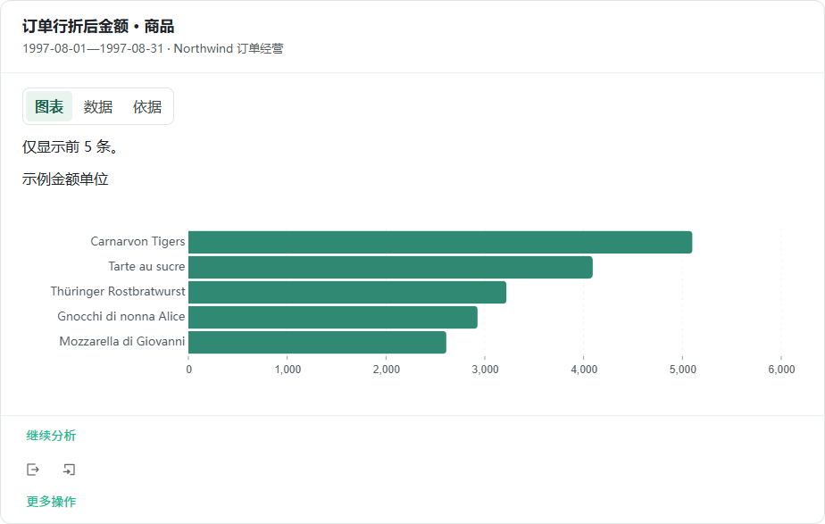
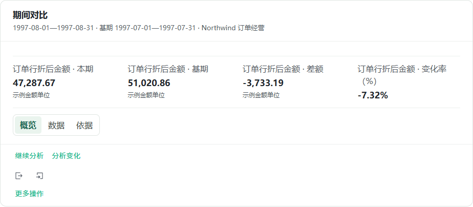
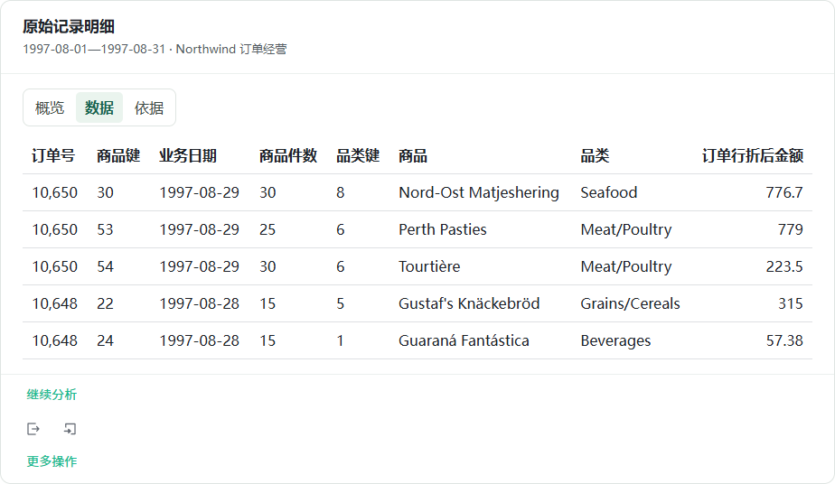
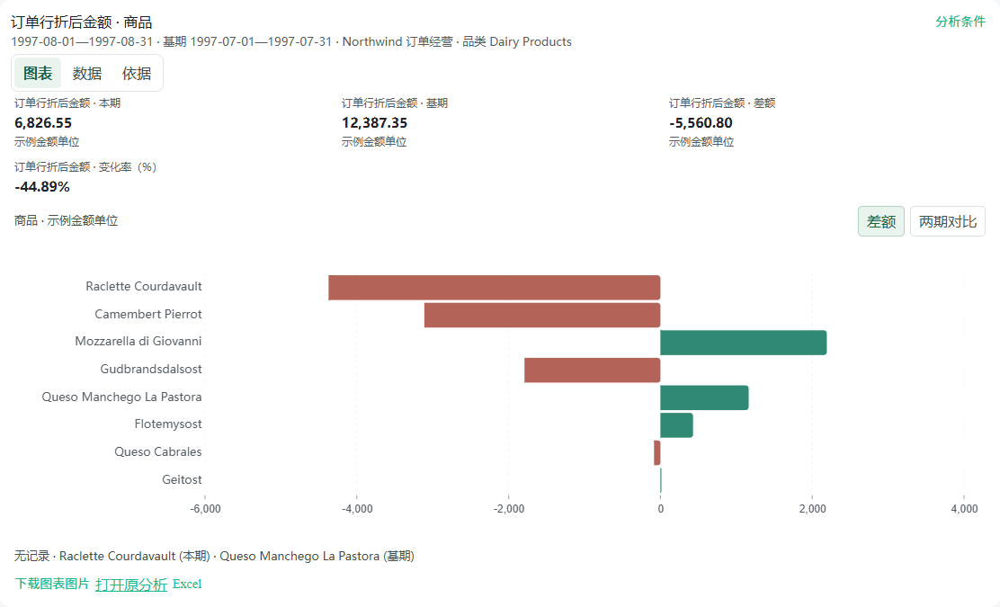
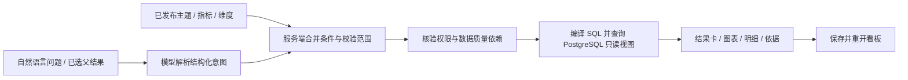
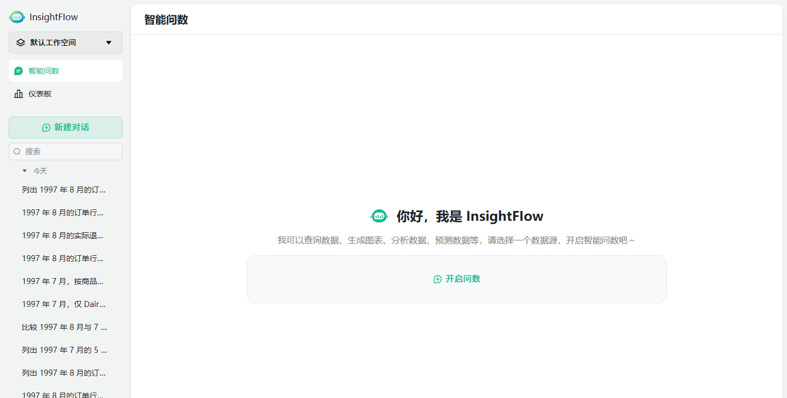

# InsightFIow · 企业经营分析工作台

InsightFIow 把常见的经营复盘串成一条可以核查的分析流程。运营人员用自然语言提问，比较两期经营表现，追到具体商品或订单行，再把能够复核的结果保存到看板。

这个项目聚焦一个具体问题。**当用户接着上一张结果卡说「换到 8 月」时，系统怎样只改日期，并保留原来的指标、筛选、排名或明细粒度？** 下图是实际运行的结果。系统沿用了原来的折后金额口径和前五条件，按 8 月的数据重新排名。



## 一次完整的经营复盘

| 用户操作 | 预期结果 |
| --- | --- |
| 在「Northwind 订单经营」问「比较 1997 年 8 月与 7 月的订单行折后金额，给出两期金额、差额和变化率」 | 本期 **47,287.67**，基期 **51,020.86**，减少 **3,733.19**，变化率 **−7.32%**。结果保留指标和两期范围，金额以示例金额单位显示。 |
| 选中这次比较并说「只把本期改成 1997 年 9 月」 | 9 月为 **55,629.24**，基期继续使用 7 月，原比较可从历史重开。 |
| 查「1997 年 7 月订单行折后金额最高的五个商品」，再从结果卡「继续分析」，输入「换到 8 月」 | 按同一指标重新计算 8 月前五。明确说「只看原来这五个商品」时，才沿用 7 月成员。 |
| 先查「1997 年 7 月的五条订单行明细」，再从该结果说「换到 8 月」 | 返回 8 月五条订单行，保留订单行粒度。记录以订单号和商品键共同标识，同一张订单可以包含多条订单行。 |
| 从两期结果查看品类贡献，打开乳制品商品明细并保存至看板 | 乳制品减少 **5,560.80**，商品差额图显示哪些商品拉低结果、哪些商品抵消部分下降。看板保留当时的比较期间、品类筛选与结果。 |



<details>
<summary>查看订单行明细与看板实机截图</summary>

**订单行明细。** 选中原来的五条明细后只改日期，系统返回八月的五条订单行。



**固定看板成果。** 重开乳制品的商品差额卡，继续查看原比较期间、筛选条件和依据。



</details>

## 主要设计与项目改造

| 能力 | 产品规则 |
| --- | --- |
| 业务主题与口径 | 数据团队准备获准的 PostgreSQL 只读业务视图。在主题配置里登记业务日期、指标、维度、数据粒度与质量规则，经过试查和发布后供问数使用。 |
| 连续追问 | 在选中的父结果上采用本轮清楚提出的修改，其余条件沿用原计划。「换到 8 月」「改看前十」「只看全期合计」分别改变日期、上限和结果粒度。 |
| 对比、下钻与证据 | 两期总量可拆到品类，再进入商品查看差额与明细。当前证据用于定位变化贡献，促销或缺货等经营原因需要相应业务记录。 |
| 异常恢复 | 口径有歧义时让用户选择。缺少退款事实时指出具体缺口，支持用户改问可回答的指标。模型解释超时或返回格式无效时，用户可从结果卡沿原问题和父结果重试。 |
| 权限与成果复用 | 执行前校验查询及必要数据质量检查所需字段。普通账号具备金额权限时可查汇总，请求受限字段的完整明细会受阻。保存至看板的结果保留其条件和版本，重开时复核访问授权。 |


## 从自然语言到结果



模型提议当前问题的意图。服务端结合主题定义和父运行确定实际使用的期间、指标、分组、筛选、排序与上限，再由数据库计算。页面保留这些条件、结果和来源，便于复核与再次使用。

| 想了解什么 | 源码入口 |
| --- | --- |
| 主题草稿、发布版本、问数评测 | [主题 API](backend/apps/chat/api/cbi_theme.py) · [主题版本维护](backend/apps/chat/curd/cbi_theme.py) |
| 首次问数、父结果、错误恢复与执行 | [分析入口](backend/apps/chat/task/cbi_analysis.py) |
| 计划继承、SQL 编译、结构化结果 | [语义解析和执行](backend/apps/chat/task/cbi_semantic.py) |
| 答案、对比图和依据的前端呈现 | [结果卡](frontend/src/views/chat/analysis/AnalysisCard.vue) · [两期对比组件](frontend/src/views/chat/workspace/ComparisonResult.vue) |
| 重点合同如何验收 | [语义计划测试](backend/tests/test_cbi_semantic.py) · [浏览器回归说明](tests/browser/README.md) |

技术栈为 **Vue 3、TypeScript、Vite、AntV G2、Python 3.11、FastAPI、SQLAlchemy 和 PostgreSQL**。

## 本地构建与体验

本地开发需要 Node.js 20+ 和 Python 3.11。完整问数还需要已初始化的 PostgreSQL 元数据库、可访问的模型配置，以及通过试查和发布的业务主题。Northwind 演示使用 PostgreSQL 16 的只读订单行视图。

在前端依赖已安装的环境中，可执行以下命令构建工作台。构建产物位于 `frontend/dist`。

```bash
cd frontend
npx --no-install vue-tsc -b
NODE_OPTIONS=--max-old-space-size=4096 npx --no-install vite build
```

具备现成运行环境后，以管理员配置模型，连接已准备好的 Northwind 只读视图，登记订单行折后金额、业务日期、商品、品类与订单行粒度，完成试查与发布。以普通账号打开「Northwind 订单经营」，可按上表体验问数、改日期、核查明细和保存看板。

本轮实机验证沿用已准备的 Windows 隔离环境及样例库。完整演示依赖上述运行条件和数据配置，从全新克隆到完整演示的自动化安装仍待整理。

<details>
<summary>查看 InsightFIow 工作台入口</summary>



</details>

## 验收与适用范围

- **连续追问。** 修前实测中，日期追问把商品前五扩大到 25。修后分别核对金额排名、订单行明细、固定基期、前十、全期合计、全部商品以及沿用原成员。
- **受阻与恢复。** 注入模型超时和返回结构无效，检查失败时的业务 SQL 次数、用户提示以及重试是否保留任务。通过两套净销售额口径、缺退款事实后的改问，以及双账号字段访问对照，验证对应交互。
- **结果与证据。** 在本地公开样例上完成 **26 轮原生页面交互**，包含澄清、预期拒答与故障注入。核对采用计划、实际 SQL、独立 PostgreSQL 复算与界面。后端定向测试 **244 项通过**。
- **当前验证范围。** 涵盖已配置主题、只读视图和应用层字段授权。企业级行权限、跨主题泛化、生产容量及真实业务提效仍待对应环境验证。
